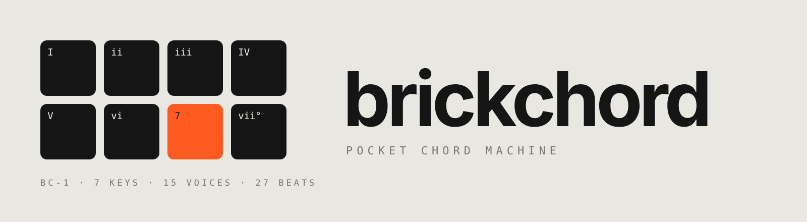

# Brickchord (alpha)

A pocket chord machine with an analog-style synth voice, built for the **TrimUI Brick Pro** running **KNULLI**.
One button plays one chord in your key, the left stick bends it, the right stick adds reverb, delay and filter,
and everything plays on a single sample-accurate clock with a built-in drum machine and synth bass.

**Website:** https://michaeltietjen.github.io/brickchord/

> Alpha software. Tested on a TrimUI Brick Pro with a KNULLI beta build. Expect rough edges.

## Features
- **7 chord buttons** (D-pad + X/A/B) play the diatonic chords of your key in Major, Minor, Dorian or Mixolydian
- **Chord modifiers**: hold Y (flip major/minor), L1 (7th), R1 (sus4), L1+R1 (9th)
- **Left stick** bends the held chord 8 ways: 7, maj7, 9, aug, flip, dim, sus4, sus2
- **Right stick** for effects: up = wetter (reverb and delay together), down = dry; left = filter, right = resonance; click to hold
- **Modes** on a wheel (click the left stick): Play, Lead (melodies with bend, vibrato and glide), Drone and Effects. Bricklab adds Drums (8 pads) and Song
- **Synth engines**: analog-VA (detuned saws, PWM, sub, resonant filter), FM, plucked strings, drawbar organ, formant vox and noise pads. 23 sounds, editable in the Sound Editor
- **Effects rack with LFOs**: Drive, Lo-fi, Chorus, Flanger, Vibrato, Tremolo, Gate, Auto-Pan, Wide, Filter LFO and Glide, stackable, tempo-synced, with randomize
- **Song mode**: 16 patterns of up to 8 bars with 6 recorded tracks each, a step grid for editing, and a song page that chains patterns. Every track keeps its own sound and effects, changeable after recording, with undo
- **Synth bass** on its own dry bus, with Synth, Pulse, Octaves, Walk, Sub + Patch, Patch and Off modes and a level control
- **15 play styles**: Chord, Strum (Folk / Pop / Skank), Slop, Harp Up / Down, 5 arpeggiators that span 1 to 4 octaves, and Repeat 1/4, 1/8, 1/16
- **Drum machine** with 27 beats (house, techno, jungle, drum & bass, 2-step, UK funky, footwork, neo-soul and more), ghost notes and swing; strums, arps and bass lock to its clock, with optional quantize
- **8 reverbs** (Hall, Room, Plate, Big Hall, Spring, Reverse, Gated, Lo-fi Dark) and **6 delays** (Ping-Pong, Straight, Tape, Dub, Slapback, Multi-Tap), tempo-synced with dotted and triplet times. Effects touch only the synth, so drums and bass stay punchy
- **An animated screen**: a self-playing Tetris well that drops a piece on every chord and clears lines in a burst of bricks, shattering chord tiles, falling chord names, a live oscilloscope, and a launch animation that plays the home chord of your key
- **Instant sound loading** from a disk cache, with an optional pre-rendered factory pack

## Bricklab
Bricklab is the groovebox built on the same engine. It adds:
- **A looper you can layer from any mode.** R2 records a layer with the sound you are playing; it closes at the bar and loops. R2 again arms the next layer. Six lamps in the header show the layers; SELECT+B undoes the last one.
- **16 patterns of 6 tracks**, each track a **machine**: Chord, Lead, Bass, Drone or Sample (track 1 is Drums). Lead, Bass and Drone have their own sound banks with a Moog-style 4-pole ladder filter. Sample plays WAVs from `samples/` pitched across the buttons, with start, end, reverse, loop, tune and a granular mode (Settings > Sample).
- **A drum machine** on track 1: 16-step grid, five built-in kits plus your own WAV kits, swing, accents, ghosts, humanize, per-lane level and tune (Settings > Drums).
- **Per-track effects**: every track has its own rack, live filter, level, pan, sends and one of two FX buses, each bus with its own reverb and delay type (Settings > FX). The track page is Effects on the mode wheel or SONG > X.
- **Sequencing**: step grid, song page that chains patterns, count-in, record and length quantize, a metronome, and Drone slide.
- **Demo songs**: Settings > Global > Demo song loads one of four songs (synthwave, lo-fi, acid, ambient) to hear what it does and pull apart.

It installs next to Brickchord: copy the `brickchord` folder to `ports/bricklab`, add a file `edition.txt` containing `lab`, and copy `Bricklab.sh` into `ports`. It shares Brickchord's sound cache when both are installed.

## Brickambient
An ambient machine on the same engine. Six drone voices (D-pad, X, Y) fade in and glide between notes over seconds or minutes, two melodic voices (A, B) step through five notes, and the screen draws each voice's pitch as a line against guides for the scale. Scenes morph the whole texture (SELECT + a drone button saves, R1 + it recalls), R2 evolves every voice to a nearby note, START freezes the cloud, the left stick spreads and moves the voices, L2 + left stick plays Cloud. Settings has a page per voice: sound, note and cents, level, pan, glide, fade, vibrato, tremolo, drift.

## Install (KNULLI)
1. Download the latest zip from **[Releases](https://github.com/michaeltietjen/brickchord/releases)** (it bundles the ARM64 NumPy that Brickchord needs).
2. Copy `brickchord/` and `Brickchord.sh` into `/userdata/roms/ports/` (on the SD card: `roms/ports/`).
3. On the device: Start → Game Settings → Update Gamelists, then open **Ports → Brickchord**.
4. On first launch, press each button once and push each stick once so Brickchord learns your controls.

**Tested firmware:** `knulli-a133-trimui-brick-pro-beta-20260921`. KNULLI for the Brick Pro is still in beta. Get it from the [KNULLI project](https://knulli.org) (public builds are on [their GitHub releases](https://github.com/knulli-cfw/distribution/releases)); Brickchord doesn't host or support the firmware itself.

## Install (R36Max, R36S and other ArkOS-family handhelds)
1. Download `brickchord-r36max-*.zip` from **[Releases](https://github.com/michaeltietjen/brickchord/releases)**.
2. Copy `Brickchord.sh` and the `brickchord/` folder from its `ports/` folder into `ports/` on the SD card.
3. Restart EmulationStation and open **Ports → Brickchord**. The screen layout adapts to the square 720×720 display.
4. First launch unpacks the NumPy (and, only if the firmware has none, pygame) that matches the device's Python, then runs button setup. If it doesn't start, see `brickchord/brickchord.log` and `INSTALL-R36.txt`.

Untested on hardware so far: feedback welcome. Build the zip yourself with `r36/build_zip.sh`.

### Instant sound loading (optional)
On a computer with Python 3 and NumPy, run `python3 brickchord/factory_render.py` from the release folder before copying it to the SD card. It pre-renders all 15 stock sounds (about 355 MB) into `brickchord/cache`, so every stock sound opens instantly. Without it, the Brick renders each sound in quiet moments the first time you use it and keeps it for next time. The pack matches sounds with Filter and Resonance at 0 in Settings; use the right stick for live filter moves.

The source in this repo does not include NumPy. To run from source, put an aarch64 / CPython 3.12 build of
NumPy in `brickchord/_vendor/` (or have NumPy available to the system Python).

## Controls
| Input | Action |
|---|---|
| D-pad ← ↑ → ↓ | Chords I, ii, iii, IV |
| X, A, B | Chords V, vi, vii° |
| Y / L1 / R1 (hold) | Flip / 7th / sus4 (L1+R1 = 9th) |
| Left stick | Chord bends (Play), bend and vibrato (Lead) |
| Click left stick | Mode wheel: push toward a mode, let go to switch |
| Right stick ↑ ↓ | Wet (reverb + delay) / dry |
| Right stick ← → | Filter / resonance |
| Click right stick | Hold the current effect settings |
| Start | Beat on/off |
| Select | Settings (L1/R1 flips pages: Global, Chords, Drums, FX) |
| Hold Select + A / B / X / Y | Song mode, from any mode: record, undo, play/stop, mute (Up/Down track, Left/Right pattern) |
| Select + Start | Quit |

In the other modes the screen shows its own controls. Song mode: L1/R1 switch between the PATTERN, GRID and SONG pages; each page shows its controls at the bottom of the screen.

## How it works
- `engine.py` mixes one continuous stereo stream in NumPy and schedules every note, strum, arp, bass note and drum hit in
  sample time. The synth goes through a live FIR filter, partitioned-FFT reverb and a choice of delays; drums and bass take a dry bus.
- `synth.py` renders each note as band-limited wavetables shaped by a resonant filter response, split into
  an attack segment and a seamless sustain loop. It also holds the sounds, beats, reverb impulses and the synth bass.
- `host.py` runs the engine on a dedicated audio thread, loads notes from the disk cache and hands any missing ones to a
  low-priority background renderer (`render_worker.py`) that pauses whenever you play.
- `main.py` is the pygame UI. Drawing is cached and frame-rate adaptive so the audio thread always comes first.

## Credits and notice
Brickchord is an original, independent project. It is not affiliated with or endorsed by TrimUI, the
KNULLI project, Pocket Audio (HiChord) or Telepathic Instruments (Orchid); its workflow was inspired by
chord instruments like those. The release zip bundles NumPy (BSD-3-Clause); see its license files in
`_vendor/`.

## License
MIT, see `LICENSE`.
